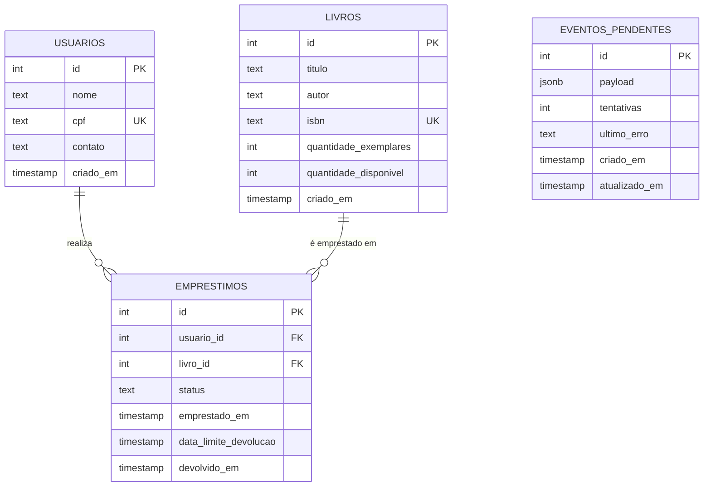

# Documento de Projeto: Sistema de Gerenciamento de Biblioteca

PUC-Campinas · Sistemas de Informação · Projeto Integrador IV · 2026-2 · Turma 102 · Grupo 05

| Integrante | RA |
|---|---|
| Victor Hugo Santos | 22968572 |
| Lucas Joaquim | 24020901 |
| Gabriel Gregorio | 20060547 |

Repositório principal (este): <https://github.com/ElVictron/pi4-0101-g5-backend-1>. Os outros dois módulos estão no capítulo 11.

---

## Capítulo 1. Visão geral

**Responsável:** _a definir_

**Problema.** Uma biblioteca pequena controla livros, leitores e empréstimos em planilhas. Quem atende não vê, na hora, quantos exemplares de um título estão livres, nem quais empréstimos passaram do prazo. Dois atendentes com a planilha aberta enxergam números diferentes, e a conferência é manual. As planilhas não impedem erros como emprestar um livro sem exemplar livre ou cadastrar o mesmo leitor duas vezes.

**Público.**

- **Responsável da biblioteca:** cadastra livros e usuários, registra empréstimos e devoluções, consulta o acervo e acompanha os atrasos. É o único perfil do sistema; não há login.

**Escopo.** O sistema entrega oito funcionalidades, do ponto de vista de quem usa:

- E1: cadastrar um livro, com título, autor, ISBN e quantidade de exemplares.
- E2: pesquisar livros e ver a quantidade disponível.
- E3: cadastrar um usuário, com nome, CPF e contato.
- E4: pesquisar usuários e ver os empréstimos de cada um.
- E5: registrar um empréstimo para um usuário, com prazo de 15 dias.
- E6: registrar a devolução, que libera o exemplar.
- E7: ver quais livros têm exemplares disponíveis, com atualização automática entre telas abertas, sem recarregar a página.
- E8: ver os empréstimos ativos, devolvidos e atrasados.

**Fora do escopo.** Não fazem parte desta versão:

- Login e perfis de acesso. O sistema não autentica quem usa as telas nem quem publica eventos no Backend 2 (limite conhecido, capítulo 7).
- Edição e exclusão de livros e usuários, renovação de empréstimo, multa e reserva de livro.
- Notificação ao leitor (e-mail ou mensagem) sobre atraso.
- Exposição na internet. O sistema foi feito para rodar em uma máquina com Docker, em rede local.

---

## Capítulo 2. Objetivos

**Responsável:** _a definir_

**Objetivo geral.** O responsável da biblioteca sabe, numa tela só, quais livros têm exemplar livre e quais empréstimos estão ativos ou atrasados, e vê qualquer empréstimo ou devolução feito em outra tela aparecer sem recarregar a página.

**Objetivos específicos.**

1. Registrar livros, usuários e empréstimos num banco único (PostgreSQL), com regras que impedem ISBN ou CPF repetidos e empréstimo sem exemplar livre.
2. Calcular a situação de cada empréstimo (ativo, devolvido ou atrasado) a partir do prazo de 15 dias.
3. Mostrar a disponibilidade dos livros num painel que se atualiza sozinho, por um segundo backend que distribui eventos em tempo real.
4. Manter o sistema funcionando quando o segundo backend cai, guardando os eventos para reenvio.
5. Usar conexões cifradas (HTTPS e WSS) entre os módulos.
6. Subir o sistema inteiro com um comando, em qualquer máquina com Docker.

**Critério de sucesso.** Com duas abas abertas, um empréstimo registrado numa aba muda a quantidade disponível no painel da outra em até 2 segundos, sem recarregar; ao devolver, o painel volta ao valor anterior. Esse cenário é o teste de ponta a ponta do capítulo 7 (TE-04).

---

## Capítulo 3. Requisitos

**Responsável:** _a definir_

### 3.1 Requisitos funcionais

Cada E tem um fluxo em `docs/fluxos/` e usa contratos CT descritos no capítulo 6. Situação em 16/11/2026: todos prontos.

<!-- CONFIRMAR prioridades e frases "feito quando" com o texto da Entrega 1 -->

### E1: Cadastro de livros
**Prioridade:** Alta · **Situação:** pronto
**Feito quando:** o responsável cadastra um livro com título, autor, ISBN e quantidade de exemplares, e o livro aparece na lista.
**Critérios de aceite:**
- A quantidade de exemplares é de no mínimo 1, e o livro nasce com todos os exemplares disponíveis.
- Um ISBN já cadastrado é recusado (`ISBN_DUPLICADO`), mesmo escrito com hífens.
- Campos em branco são recusados com mensagem de erro.

**Fluxo:** [E1-cadastro-de-livros.md](fluxos/E1-cadastro-de-livros.md) · **Contratos:** CT1 cadastrarLivro, CT9 livros

### E2: Consulta de livros
**Prioridade:** Média · **Situação:** pronto
**Feito quando:** o responsável pesquisa um livro e visualiza seus dados e a quantidade disponível.
**Critérios de aceite:**
- A busca ignora maiúsculas e acentos.
- A lista mostra a quantidade de exemplares e a quantidade disponível de cada livro.
- A lista é paginada.

**Fluxo:** [E2-consulta-de-livros.md](fluxos/E2-consulta-de-livros.md) · **Contratos:** CT2 consultarLivros, CT9 livros

### E3: Cadastro de usuários
**Prioridade:** Alta · **Situação:** pronto
**Feito quando:** o responsável cadastra um usuário com nome, CPF e contato, e ele aparece na lista.
**Critérios de aceite:**
- O CPF é guardado só com os 11 dígitos, sem pontos nem traço.
- Um CPF já cadastrado é recusado (`CPF_DUPLICADO`).
- Campos em branco são recusados.

**Fluxo:** [E3-cadastro-de-usuarios.md](fluxos/E3-cadastro-de-usuarios.md) · **Contratos:** CT3 cadastrarUsuario, CT10 usuarios

### E4: Consulta de usuários
**Prioridade:** Média · **Situação:** pronto
**Feito quando:** o responsável pesquisa um usuário e visualiza seus dados e empréstimos.
**Critérios de aceite:**
- A busca encontra por nome (sem acento nem maiúsculas) ou por trecho do CPF.
- Cada usuário traz a lista dos seus empréstimos, vazia se não houver.

**Fluxo:** [E4-consulta-de-usuarios.md](fluxos/E4-consulta-de-usuarios.md) · **Contratos:** CT4 consultarUsuarios, CT10 usuarios, CT11 emprestimos

### E5: Registro de empréstimo
**Prioridade:** Alta · **Situação:** pronto
**Feito quando:** o responsável seleciona um usuário e um livro disponível, e o empréstimo é registrado no sistema.
**Critérios de aceite:**
- O prazo de devolução é de 15 dias após o empréstimo.
- Um livro sem exemplar livre é recusado (`LIVRO_INDISPONIVEL`), e a quantidade disponível nunca fica negativa.
- Registrar o empréstimo reduz em 1 a quantidade disponível.
- O painel de outra aba mostra a nova disponibilidade sem recarregar.

**Fluxo:** [E5-registro-de-emprestimo.md](fluxos/E5-registro-de-emprestimo.md) · **Contratos:** CT5 registrarEmprestimo, CT9, CT10, CT11, CT12, CT13

### E6: Registro de devolução
**Prioridade:** Alta · **Situação:** pronto
**Feito quando:** o responsável registra a devolução de um livro e o exemplar volta a ficar disponível.
**Critérios de aceite:**
- A devolução aumenta em 1 a quantidade disponível.
- Devolver um empréstimo já devolvido é recusado (`EMPRESTIMO_JA_DEVOLVIDO`).
- O painel de outra aba mostra a disponibilidade de volta sem recarregar.

**Fluxo:** [E6-registro-de-devolucao.md](fluxos/E6-registro-de-devolucao.md) · **Contratos:** CT6 registrarDevolucao, CT9, CT11, CT12, CT13

### E7: Controle de disponibilidade
**Prioridade:** Média · **Situação:** pronto
**Feito quando:** o sistema apresenta quais livros possuem exemplares disponíveis para empréstimo.
**Critérios de aceite:**
- O painel lista os livros com a quantidade disponível.
- O painel se atualiza ao receber um evento em tempo real e volta a se conectar sozinho se a conexão cair.
- Um evento mais antigo que o já mostrado para o mesmo livro não faz o painel voltar atrás.

**Fluxo:** [E7-controle-de-disponibilidade.md](fluxos/E7-controle-de-disponibilidade.md) · **Contratos:** CT7 listarDisponibilidade, CT12, CT13

### E8: Consulta de empréstimos
**Prioridade:** Média · **Situação:** pronto
**Feito quando:** o responsável visualiza os empréstimos ativos, devolvidos e atrasados.
**Critérios de aceite:**
- O filtro de situação aceita `ativo`, `devolvido` e `atrasado`; outro valor é recusado (`STATUS_INVALIDO`).
- Um empréstimo ativo com o prazo vencido aparece como `atrasado`, sem ser regravado no banco.
- A busca procura pelo nome do usuário ou pelo título do livro.

**Fluxo:** [E8-consulta-de-emprestimos.md](fluxos/E8-consulta-de-emprestimos.md) · **Contratos:** CT8 consultarEmprestimos, CT11 emprestimos

### 3.2 Requisitos não funcionais

| ID | Requisito | Como verificar |
|---|---|---|
| RNF-01 | O sistema inteiro (frontend, Backend 1, Backend 2 e PostgreSQL) sobe com `docker compose up --build`, sem passo manual além de ter os três repositórios lado a lado. | TE-01 |
| RNF-02 | O banco nasce do script `db/schema.sql` num volume vazio, sem erro. | TE-02 |
| RNF-03 | Se o Backend 2 estiver fora do ar, o Backend 1 continua atendendo as telas, guarda o evento na tabela `eventos_pendentes` e o reenvia com `python -m app.reenviar_eventos`. A entrega é "pelo menos uma vez" e sem garantia de ordem. | TE-03 |
| RNF-04 | Um empréstimo ou devolução aparece no painel de outra aba em até 2 segundos, sem recarregar a página. | TE-04 |
| RNF-05 | Senha do banco e certificados vêm de variáveis de ambiente e da pasta `certs/`, que não vai para o GitHub. O valor padrão da senha do banco (`biblioteca`) serve só para desenvolvimento local. | TE-05 |
| RNF-06 | O sistema guarda nome, CPF e contato dos usuários, usados só para identificar quem pegou o livro. O evento enviado às telas em tempo real não leva nenhum dado do usuário. | TE-06 |
| RNF-07 | Backend 1 → Backend 2 usa HTTPS e Backend 2 → frontend usa WSS, com verificação do certificado. O Backend 2 só sobe com TLS. | TE-07 |
| RNF-08 | Eventos repetidos ou fora de ordem não fazem o painel mostrar um valor mais antigo. | TE-08 |

### 3.3 Rastreabilidade

| Entregável | Fluxo | Contratos | Testes |
|---|---|---|---|
| E1 Cadastro de livros | E1-cadastro-de-livros.md | CT1, CT9 | TE-11, TE-12 |
| E2 Consulta de livros | E2-consulta-de-livros.md | CT2, CT9 | TE-21, TE-22 |
| E3 Cadastro de usuários | E3-cadastro-de-usuarios.md | CT3, CT10 | TE-31, TE-32 |
| E4 Consulta de usuários | E4-consulta-de-usuarios.md | CT4, CT10, CT11 | TE-41, TE-42 |
| E5 Registro de empréstimo | E5-registro-de-emprestimo.md | CT5, CT9–CT13 | TE-04, TE-51, TE-52 |
| E6 Registro de devolução | E6-registro-de-devolucao.md | CT6, CT9, CT11–CT13 | TE-04, TE-61, TE-62 |
| E7 Controle de disponibilidade | E7-controle-de-disponibilidade.md | CT7, CT12, CT13 | TE-04, TE-08, TE-71 |
| E8 Consulta de empréstimos | E8-consulta-de-emprestimos.md | CT8, CT11 | TE-81, TE-82 |

---

## Capítulo 4. Arquitetura

**Responsável:** _a definir_

### 4.1 Visão da arquitetura

O sistema tem quatro contêineres e um serviço auxiliar que roda uma vez. O frontend (React) é o que o responsável usa. Ele chama o Backend 1 para as operações e recebe do Backend 2 as atualizações em tempo real. O Backend 1 guarda os dados no PostgreSQL e, depois de cada empréstimo ou devolução, publica um evento no Backend 2, que o repassa às telas abertas.

### 4.2 Implantação com Docker

Fonte: [`docker-compose.yml`](../docker-compose.yml) deste repositório. Os repositórios do Backend 2 e do frontend ficam em pastas irmãs (`../pi4-0101-g5-backend-2`, `../pi4-0101-g5-frontend`).

| Serviço | Imagem | Porta | Publicada? | Depende de |
|---|---|---|---|---|
| postgres | `postgres:16` | 5432 | não (só na rede do Compose) | nenhum |
| certificados | `alpine:3` | n/a | n/a (roda e termina) | nenhum |
| backend2 | build de `../pi4-0101-g5-backend-2` (Python 3.12) | 8443 (HTTPS/WSS) | sim, `8443:8443` | certificados (concluído) |
| backend1 | build de `.` (Python 3.12) | 8000 | sim, `8000:8000` | postgres (saudável) e backend2 (saudável) |
| frontend | build de `../pi4-0101-g5-frontend` (Node, servido por Nginx) | 80 | sim, `5173:80` | backend1 |

Dentro da rede do Compose, cada serviço é encontrado pelo nome: o Backend 1 chama `https://backend2:8443` e o banco em `postgres:5432`. O navegador, que roda fora da rede do Compose, chama o Backend 1 em `localhost:8000` e o Backend 2 em `wss://localhost:8443`. Por isso o frontend recebe `VITE_API_URL` e `VITE_WS_URL` no build.

O serviço `certificados` gera, na primeira subida, uma CA local e o certificado do Backend 2 (válido para `localhost` e `backend2`) na pasta `certs/`. O Backend 1 verifica o certificado com a CA (`BACKEND2_CA_BUNDLE=/certs/ca.pem`). Para o navegador aceitar o WSS sem aviso, é preciso confiar em `certs/ca.pem` (passos no README).

### 4.3 Comunicação entre os backends e as telas

| Item | Valor |
|---|---|
| Backend 1 → Backend 2 | `POST https://backend2:8443/eventos/biblioteca`, JSON, contrato CT12 (corpo de até 64 KiB) |
| Backend 2 → telas | WebSocket seguro em `wss://localhost:8443/ws/biblioteca`, uma mensagem JSON por evento, contrato CT13 |
| Servidor | Backend 2 (Uvicorn, só aceita TLS) |
| Cliente | Backend 1 (HTTPS) e o navegador (WSS) |
| Se o Backend 2 cair | Backend 1 guarda o evento em `eventos_pendentes` e segue atendendo; o reenvio é `python -m app.reenviar_eventos`. As telas abertas tentam reconectar sozinhas |
| Painel lento | Cada painel tem uma fila de 32 mensagens; se encher, o Backend 2 o desconecta (código 1013) sem atrasar os outros |
| Duplicados e ordem | Entrega "pelo menos uma vez", sem ordem garantida; o frontend ignora o evento de um livro mais antigo que o já mostrado (`atualizadaEm`) |

### 4.4 Tecnologias

| Camada | Tecnologia | Por que escolhemos |
|---|---|---|
| Frontend | React 18, Vite 7, servido pelo Nginx | Telas interativas e o painel que se atualiza sozinho |
| Backend 1 | Python 3.12+, FastAPI, Uvicorn, psycopg 3, httpx | Regras de negócio e a API (ADR 0001) |
| Backend 2 | Python 3.12, FastAPI, Uvicorn | WebSocket em Python em vez de Java (ADR 0004) |
| Banco | PostgreSQL 16 | Relacional, com chaves estrangeiras e restrições (ADR 0002) |
| Contêineres | Docker e Docker Compose | Sobe tudo igual em qualquer máquina |
| Qualidade | pytest, Vitest, Ruff, GitHub Actions, SonarQube Cloud | Testes e análise a cada push |

---

## Capítulo 5. Banco de dados

**Responsável:** _a definir_

Fonte: [`db/schema.sql`](../db/schema.sql), aplicado ao criar o volume do PostgreSQL.

- **livros** (CT9): cada título, com o total de exemplares e quantos estão disponíveis. O ISBN é único, `quantidade_exemplares` é no mínimo 1 e `quantidade_disponivel` fica entre 0 e o total.
- **usuarios** (CT10): quem pega livros emprestados. O CPF é único.
- **emprestimos** (CT11): um empréstimo liga um usuário a um livro (1:N em cada lado). `status` é `ativo` ou `devolvido`; `devolvido_em` só existe quando devolvido. O estado `atrasado` não é gravado: é calculado na consulta, comparando `data_limite_devolucao` com a data atual (CT8).
- **eventos_pendentes**: eventos que o Backend 2 não aceitou, guardados em JSON com o número de tentativas e o último erro, para o reenvio. Não tem chave estrangeira.

---

## Capítulo 6. Contratos e decisões

**Responsável:** _a definir_

Os contratos e os ADRs ficam no repositório de cada módulo. Aqui estão só os links.

### Contratos

| ID | Nome | Fronteira | Atende | Onde está |
|---|---|---|---|---|
| CT1 | cadastrarLivro | Frontend → Backend 1 (HTTPS/JSON) | E1 | [Backend 1](contratos/CT1-cadastrarLivro.md) |
| CT2 | consultarLivros | Frontend → Backend 1 | E2 | [Backend 1](contratos/CT2-consultarLivros.md) |
| CT3 | cadastrarUsuario | Frontend → Backend 1 | E3 | [Backend 1](contratos/CT3-cadastrarUsuario.md) |
| CT4 | consultarUsuarios | Frontend → Backend 1 | E4 | [Backend 1](contratos/CT4-consultarUsuarios.md) |
| CT5 | registrarEmprestimo | Frontend → Backend 1 | E5 | [Backend 1](contratos/CT5-registrarEmprestimo.md) |
| CT6 | registrarDevolucao | Frontend → Backend 1 | E6 | [Backend 1](contratos/CT6-registrarDevolucao.md) |
| CT7 | listarDisponibilidade | Frontend → Backend 1 | E7 | [Backend 1](contratos/CT7-listarDisponibilidade.md) |
| CT8 | consultarEmprestimos | Frontend → Backend 1 | E8 | [Backend 1](contratos/CT8-consultarEmprestimos.md) |
| CT9 | livros | Backend 1 → Banco (SQL) | E1, E2, E5, E6 | [Backend 1](contratos/CT9-livros.md) |
| CT10 | usuarios | Backend 1 → Banco | E3, E4, E5 | [Backend 1](contratos/CT10-usuarios.md) |
| CT11 | emprestimos | Backend 1 → Banco | E4, E5, E6, E8 | [Backend 1](contratos/CT11-emprestimos.md) |
| CT12 | publicarAtualizacao | Backend 1 → Backend 2 (HTTPS/JSON) | E5, E6, E7 | [Backend 2](https://github.com/ElVictron/pi4-0101-g5-backend-2/blob/main/docs/contratos/CT12-publicarAtualizacao.md) |
| CT13 | bibliotecaAtualizada | Backend 2 → Frontend (WSS/JSON) | E5, E6, E7 | [Backend 2](https://github.com/ElVictron/pi4-0101-g5-backend-2/blob/main/docs/contratos/CT13-bibliotecaAtualizada.md) |

As convenções comuns (formato de erro, códigos HTTP, datas, normalização de CPF e ISBN) estão em [00-convencoes.md](contratos/00-convencoes.md).

### Decisões (ADR)

| ADR | Título | Status | Onde está |
|---|---|---|---|
| 0001 | Usar Python no backend | aceito | [Backend 1](adr/0001-usar-python-no-backend.md) |
| 0002 | Usar PostgreSQL como banco de dados | aceito | [Backend 1](adr/0002-usar-postgresql-como-banco-de-dados.md) |
| 0003 | Implementar o WebSocket em Java | substituído pelo ADR 0004 | [Backend 1](adr/0003-implementar-websocket-em-java.md) |
| 0004 | Implementar o componente WebSocket em Python | aceito | [Backend 1](adr/0004-websocket-em-python.md) |
| 0005 | Compose único com TLS e CA local | aceito | [Backend 1](adr/0005-compose-unico-com-tls-e-ca-local.md) |
| 0006 | Entrega de eventos "pelo menos uma vez", com reenvio | aceito | [Backend 1](adr/0006-entrega-de-eventos-pelo-menos-uma-vez.md) |
