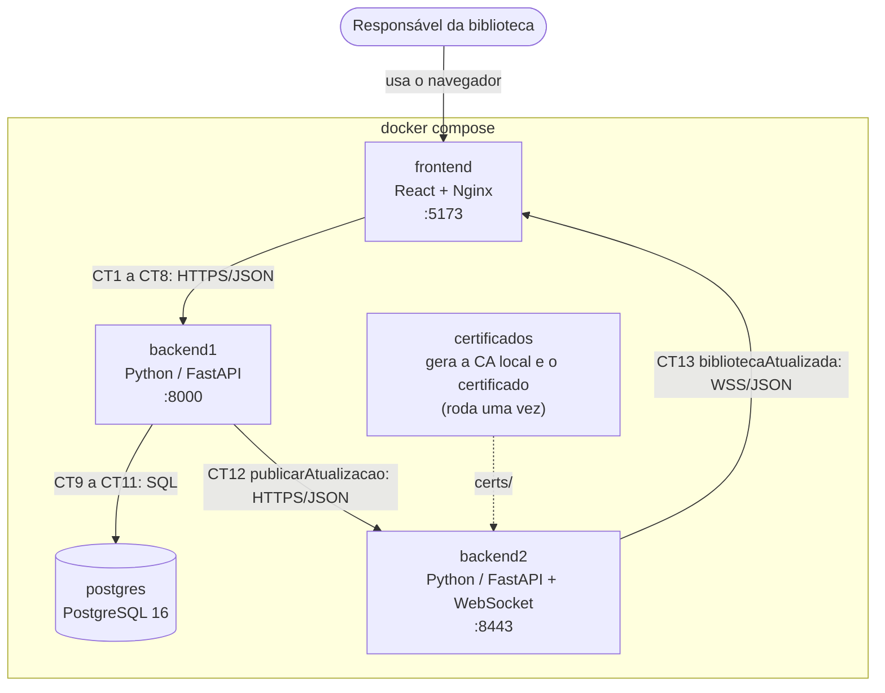
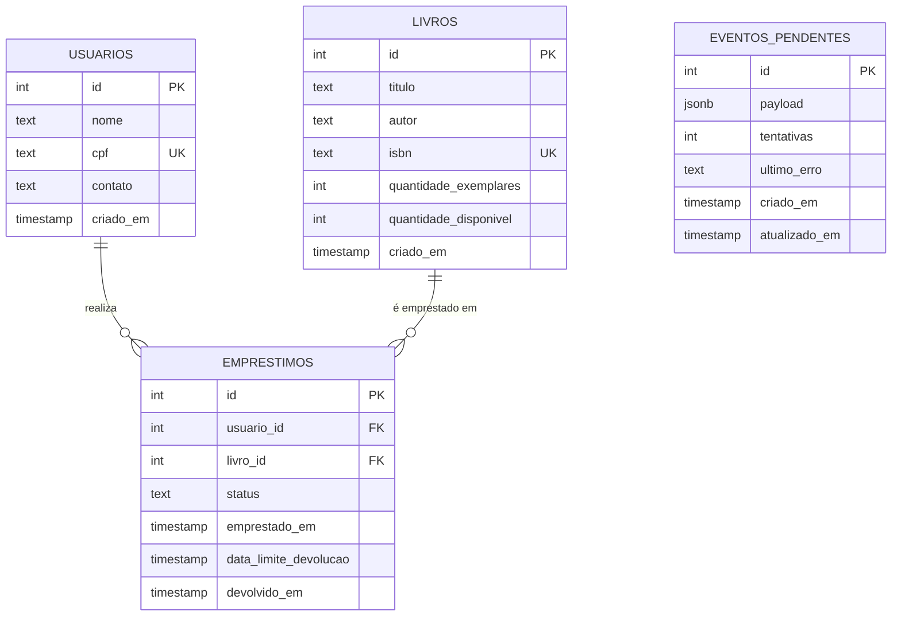
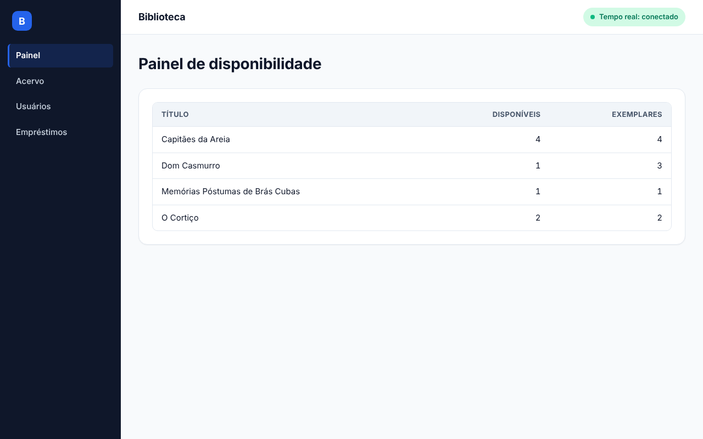
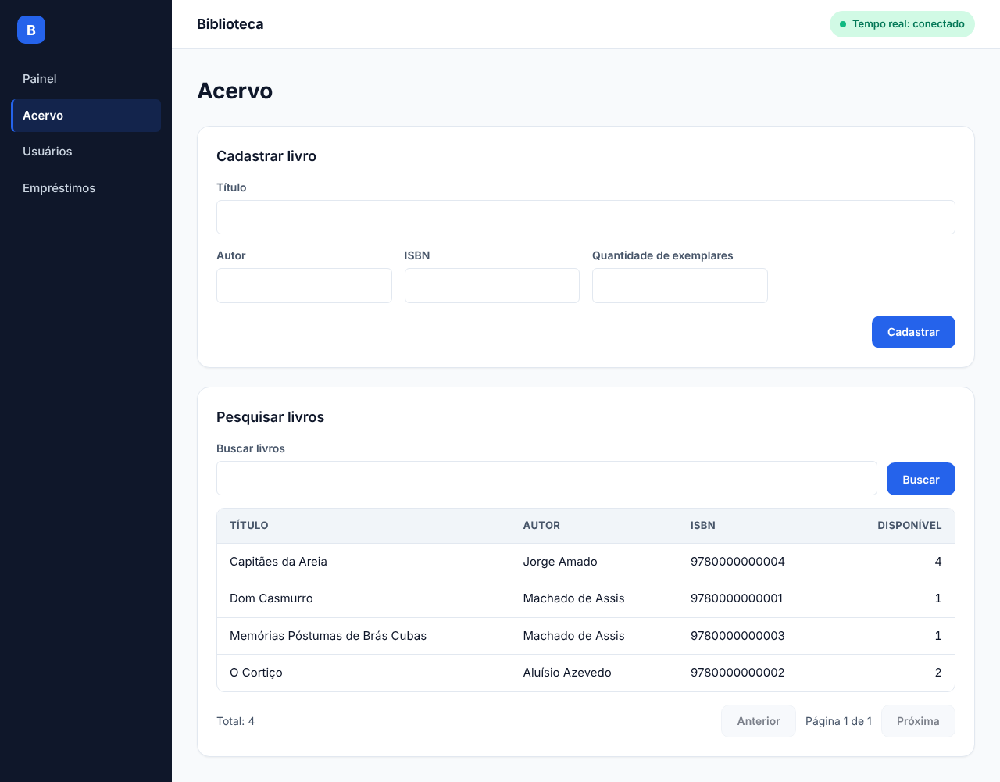
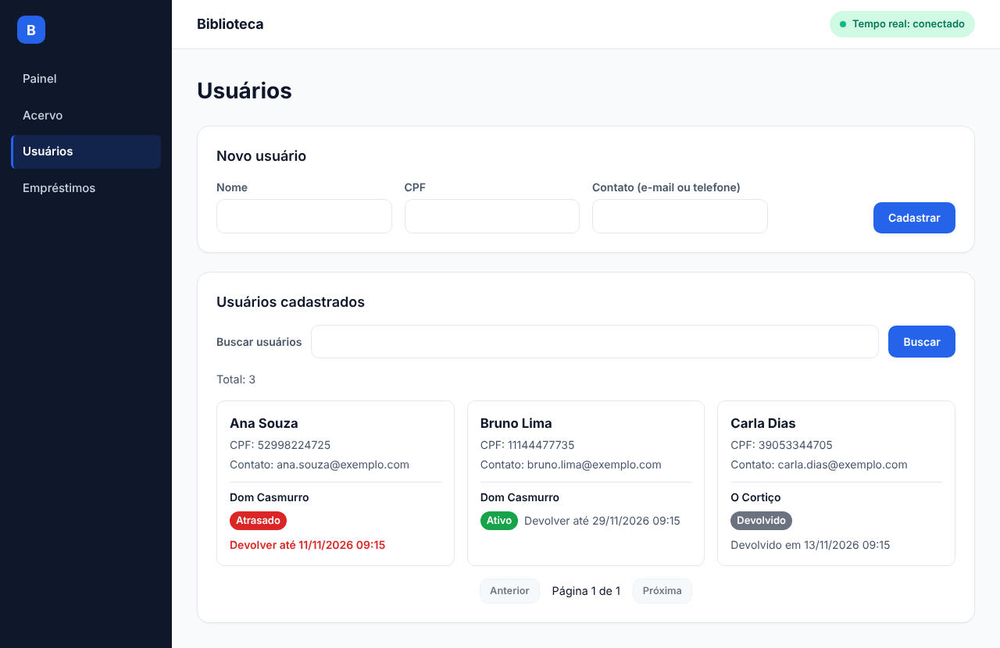
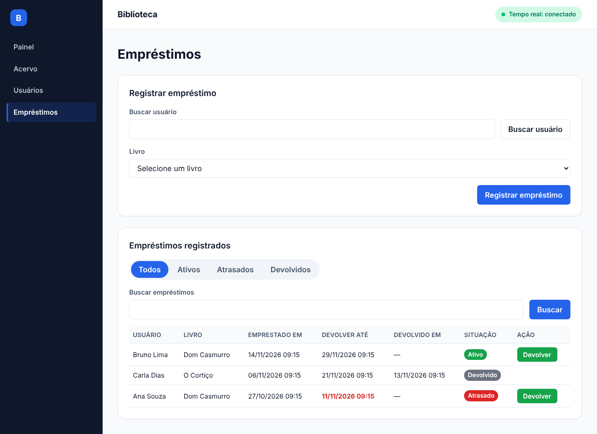

# Documento de Projeto: Sistema de Gerenciamento de Biblioteca

PUC-Campinas · Sistemas de Informação · Projeto Integrador IV · 2026-2 · Turma 102 · Grupo 05

| Integrante | RA |
|---|---|
| Victor Hugo Santos | 22968572 |
| Lucas Joaquim | 24020901 |
| Gabriel Gregorio | 20060547 |

Orientador: Douglas Henrique de Siqueira de Abreu.

Repositório principal (este): <https://github.com/ElVictron/pi4-0101-g5-backend-1>. Os outros módulos e o repositório da Entrega 1 estão no capítulo 11.

---

## Capítulo 1. Visão geral

**Responsável:** Gabriel Gregorio Ribeiro Leite

**Problema.** Hoje o responsável pela biblioteca controla livros, usuários e empréstimos de forma manual, por registros e planilhas. Isso dificulta verificar rapidamente quais livros estão disponíveis e acompanhar empréstimos e devoluções. A evidência é uma conversa com o responsável por uma biblioteca, que relatou o controle manual em planilhas e a dificuldade de saber a disponibilidade dos livros e de acompanhar as devoluções (Entrega 1). As planilhas também não impedem erros como emprestar um livro sem exemplar livre ou cadastrar o mesmo usuário duas vezes.

**Público.**

- **Responsável da biblioteca:** cadastra livros e usuários, registra empréstimos e devoluções, consulta o acervo e acompanha os atrasos. É o único perfil do sistema; não há login.

**Escopo.** O sistema entrega oito funcionalidades, do ponto de vista de quem usa:

- E1: cadastrar um livro, com título, autor, ISBN e quantidade de exemplares.
- E2: pesquisar livros e ver a quantidade disponível.
- E3: cadastrar um usuário, com nome, CPF e contato.
- E4: pesquisar usuários e ver os empréstimos de cada um.
- E5: registrar um empréstimo para um usuário, com prazo de 15 dias.
- E6: registrar a devolução, que libera o exemplar.
- E7: ver quais livros têm exemplares disponíveis, com atualização automática entre telas abertas, sem recarregar a página.
- E8: ver os empréstimos ativos, devolvidos e atrasados.

**Fora do escopo.**

| O que fica de fora | Por quê |
|---|---|
| Aplicativo mobile nativo | O projeto é uma aplicação web responsiva, sem segunda aplicação para manter |
| Sistema de multas e pagamentos | Traria regras financeiras desnecessárias ao objetivo principal |
| Reserva de livros | Aumentaria a complexidade do controle de disponibilidade |
| Integração com bibliotecas externas | Exigiria APIs e serviços externos |

Durante o desenvolvimento ficaram de fora também, sem constar na Entrega 1: login e perfis de acesso (o sistema não autentica quem usa as telas nem quem publica eventos no Backend 2, limite conhecido do capítulo 7), edição e exclusão de livros e usuários, renovação de empréstimo e aviso ao usuário sobre atraso. O sistema foi feito para rodar numa máquina com Docker, em rede local.

---

## Capítulo 2. Objetivos

**Responsável:** Gabriel Gregorio Ribeiro Leite

**Objetivo geral.** Construir um sistema web de gerenciamento de biblioteca que permita controlar livros, usuários e empréstimos, facilitando o acompanhamento da disponibilidade dos exemplares e das devoluções (Entrega 1).

**Objetivos específicos.**

- **OE1.** Cadastrar e consultar livros e seus exemplares (E1, E2).
- **OE2.** Cadastrar e consultar usuários da biblioteca (E3, E4).
- **OE3.** Registrar empréstimos e devoluções de livros (E5, E6).
- **OE4.** Acompanhar a disponibilidade dos livros e os empréstimos em andamento (E7, E8).

Na implementação, acrescentamos como metas técnicas: atualizar o painel de disponibilidade sozinho entre telas abertas (por um segundo backend), manter o sistema funcionando se esse backend cair, usar conexões cifradas entre os módulos e subir tudo com um comando.

**Critério de sucesso.** Em dezembro, o responsável pela biblioteca consegue cadastrar e consultar livros e usuários, realizar empréstimos e devoluções e verificar a disponibilidade dos exemplares por meio do sistema, sem controle manual (Entrega 1). Medimos o critério com o teste de ponta a ponta do capítulo 7: com duas abas abertas, um empréstimo registrado numa aba muda a disponibilidade no painel da outra em até 2 segundos, sem recarregar, e a devolução faz o caminho inverso (TE-04).

---

## Capítulo 3. Requisitos

**Responsável:** Gabriel Gregorio Ribeiro Leite

### 3.1 Requisitos funcionais

Cada E tem um fluxo em `docs/fluxos/` e usa contratos CT descritos no capítulo 6. Situação em 16/11/2026: todos prontos.

As frases "feito quando" e os tamanhos (P ou M) vêm da Entrega 1. A prioridade foi definida pelo grupo para esta entrega: Alta para o que o responsável não consegue trabalhar sem (E1, E3, E5, E6), Média para as consultas.

### E1: Cadastro de livros
**Prioridade:** Alta · **Tamanho:** M · **Situação:** pronto
**Feito quando:** o responsável cadastra um livro com título, autor, ISBN e quantidade de exemplares, e o livro aparece na lista.
**Critérios de aceite:**
- A quantidade de exemplares é de no mínimo 1, e o livro nasce com todos os exemplares disponíveis.
- Um ISBN já cadastrado é recusado (`ISBN_DUPLICADO`), mesmo escrito com hífens.
- Campos em branco são recusados com mensagem de erro.

**Fluxo:** [E1-cadastro-de-livros.md](fluxos/E1-cadastro-de-livros.md) · **Contratos:** CT1 cadastrarLivro, CT9 livros

### E2: Consulta de livros
**Prioridade:** Média · **Tamanho:** P · **Situação:** pronto
**Feito quando:** o responsável pesquisa um livro e visualiza seus dados e a quantidade disponível.
**Critérios de aceite:**
- A busca ignora maiúsculas e acentos.
- A lista mostra a quantidade de exemplares e a quantidade disponível de cada livro.
- A lista é paginada.

**Fluxo:** [E2-consulta-de-livros.md](fluxos/E2-consulta-de-livros.md) · **Contratos:** CT2 consultarLivros, CT9 livros

### E3: Cadastro de usuários
**Prioridade:** Alta · **Tamanho:** M · **Situação:** pronto
**Feito quando:** o responsável cadastra um usuário com nome, CPF e contato, e ele aparece na lista.
**Critérios de aceite:**
- O CPF é guardado só com os 11 dígitos, sem pontos nem traço.
- Um CPF já cadastrado é recusado (`CPF_DUPLICADO`).
- Campos em branco são recusados.

**Fluxo:** [E3-cadastro-de-usuarios.md](fluxos/E3-cadastro-de-usuarios.md) · **Contratos:** CT3 cadastrarUsuario, CT10 usuarios

### E4: Consulta de usuários
**Prioridade:** Média · **Tamanho:** P · **Situação:** pronto
**Feito quando:** o responsável pesquisa um usuário e visualiza seus dados e empréstimos.
**Critérios de aceite:**
- A busca encontra por nome (sem acento nem maiúsculas) ou por trecho do CPF.
- Cada usuário traz a lista dos seus empréstimos, vazia se não houver.

**Fluxo:** [E4-consulta-de-usuarios.md](fluxos/E4-consulta-de-usuarios.md) · **Contratos:** CT4 consultarUsuarios, CT10 usuarios, CT11 emprestimos

### E5: Registro de empréstimo
**Prioridade:** Alta · **Tamanho:** M · **Situação:** pronto
**Feito quando:** o responsável seleciona um usuário e um livro disponível, e o empréstimo é registrado no sistema.
**Critérios de aceite:**
- O prazo de devolução é de 15 dias após o empréstimo.
- Um livro sem exemplar livre é recusado (`LIVRO_INDISPONIVEL`), e a quantidade disponível nunca fica negativa.
- Registrar o empréstimo reduz em 1 a quantidade disponível.
- O painel de outra aba mostra a nova disponibilidade sem recarregar.

**Fluxo:** [E5-registro-de-emprestimo.md](fluxos/E5-registro-de-emprestimo.md) · **Contratos:** CT5 registrarEmprestimo, CT9, CT10, CT11, CT12, CT13

### E6: Registro de devolução
**Prioridade:** Alta · **Tamanho:** M · **Situação:** pronto
**Feito quando:** o responsável registra a devolução de um livro e o exemplar volta a ficar disponível.
**Critérios de aceite:**
- A devolução aumenta em 1 a quantidade disponível.
- Devolver um empréstimo já devolvido é recusado (`EMPRESTIMO_JA_DEVOLVIDO`).
- O painel de outra aba mostra a disponibilidade de volta sem recarregar.

**Fluxo:** [E6-registro-de-devolucao.md](fluxos/E6-registro-de-devolucao.md) · **Contratos:** CT6 registrarDevolucao, CT9, CT11, CT12, CT13

### E7: Controle de disponibilidade
**Prioridade:** Média · **Tamanho:** M · **Situação:** pronto
**Feito quando:** o sistema apresenta quais livros possuem exemplares disponíveis para empréstimo.
**Critérios de aceite:**
- O painel lista os livros com a quantidade disponível.
- O painel se atualiza ao receber um evento em tempo real e volta a se conectar sozinho se a conexão cair.
- Um evento mais antigo que o já mostrado para o mesmo livro não faz o painel voltar atrás.

**Fluxo:** [E7-controle-de-disponibilidade.md](fluxos/E7-controle-de-disponibilidade.md) · **Contratos:** CT7 listarDisponibilidade, CT12, CT13

### E8: Consulta de empréstimos
**Prioridade:** Média · **Tamanho:** M · **Situação:** pronto
**Feito quando:** o responsável visualiza os empréstimos ativos, devolvidos e atrasados.
**Critérios de aceite:**
- O filtro de situação aceita `ativo`, `devolvido` e `atrasado`; outro valor é recusado (`STATUS_INVALIDO`).
- Um empréstimo ativo com o prazo vencido aparece como `atrasado`, sem ser regravado no banco.
- A busca procura pelo nome do usuário ou pelo título do livro.

**Fluxo:** [E8-consulta-de-emprestimos.md](fluxos/E8-consulta-de-emprestimos.md) · **Contratos:** CT8 consultarEmprestimos, CT11 emprestimos

### 3.2 Requisitos não funcionais

| ID | Requisito | Como verificar |
|---|---|---|
| RNF-01 | O sistema inteiro (frontend, Backend 1, Backend 2 e PostgreSQL) sobe com `docker compose up --build`, sem passo manual além de ter os três repositórios lado a lado. | TE-01 |
| RNF-02 | O banco nasce do script `db/schema.sql` num volume vazio, sem erro. | TE-02 |
| RNF-03 | Se o Backend 2 estiver fora do ar, o Backend 1 continua atendendo as telas, guarda o evento na tabela `eventos_pendentes` e o reenvia com `python -m app.reenviar_eventos`. A entrega é "pelo menos uma vez" e sem garantia de ordem. | TE-03 |
| RNF-04 | Um empréstimo ou devolução aparece no painel de outra aba em até 2 segundos, sem recarregar a página. | TE-04 |
| RNF-05 | Senha do banco e certificados vêm de variáveis de ambiente e da pasta `certs/`, que não vai para o GitHub. O valor padrão da senha do banco (`biblioteca`) serve só para desenvolvimento local. | TE-05 |
| RNF-06 | O sistema guarda nome, CPF e contato dos usuários, usados só para identificar quem pegou o livro. O evento enviado às telas em tempo real não leva nenhum dado do usuário. | TE-06 |
| RNF-07 | Backend 1 → Backend 2 usa HTTPS e Backend 2 → frontend usa WSS, com verificação do certificado. O Backend 2 só sobe com TLS. | TE-07 |
| RNF-08 | Eventos repetidos ou fora de ordem não fazem o painel mostrar um valor mais antigo. | TE-08 |

### 3.3 Rastreabilidade

| Entregável | Fluxo | Contratos | Testes |
|---|---|---|---|
| E1 Cadastro de livros | E1-cadastro-de-livros.md | CT1, CT9 | TE-11, TE-12 |
| E2 Consulta de livros | E2-consulta-de-livros.md | CT2, CT9 | TE-21, TE-22 |
| E3 Cadastro de usuários | E3-cadastro-de-usuarios.md | CT3, CT10 | TE-31, TE-32 |
| E4 Consulta de usuários | E4-consulta-de-usuarios.md | CT4, CT10, CT11 | TE-41, TE-42 |
| E5 Registro de empréstimo | E5-registro-de-emprestimo.md | CT5, CT9–CT13 | TE-04, TE-51, TE-52 |
| E6 Registro de devolução | E6-registro-de-devolucao.md | CT6, CT9, CT11–CT13 | TE-04, TE-61, TE-62 |
| E7 Controle de disponibilidade | E7-controle-de-disponibilidade.md | CT7, CT12, CT13 | TE-04, TE-08, TE-71 |
| E8 Consulta de empréstimos | E8-consulta-de-emprestimos.md | CT8, CT11 | TE-81, TE-82 |

---

## Capítulo 4. Arquitetura

**Responsável:** Victor Hugo Gulino dos Santos

### 4.1 Visão da arquitetura

O sistema tem quatro contêineres e um serviço auxiliar que roda uma vez. O frontend (React) é o que o responsável usa. Ele chama o Backend 1 para as operações e recebe do Backend 2 as atualizações em tempo real. O Backend 1 guarda os dados no PostgreSQL e, depois de cada empréstimo ou devolução, publica um evento no Backend 2, que o repassa às telas abertas.

### 4.2 Implantação com Docker

Fonte: [`docker-compose.yml`](../docker-compose.yml) deste repositório. Os repositórios do Backend 2 e do frontend ficam em pastas irmãs (`../pi4-0101-g5-backend-2`, `../pi4-0101-g5-frontend`).

| Serviço | Imagem | Porta | Publicada? | Depende de |
|---|---|---|---|---|
| postgres | `postgres:16` | 5432 | não (só na rede do Compose) | nenhum |
| certificados | `alpine:3` | n/a | n/a (roda e termina) | nenhum |
| backend2 | build de `../pi4-0101-g5-backend-2` (Python 3.12) | 8443 (HTTPS/WSS) | sim, `8443:8443` | certificados (concluído) |
| backend1 | build de `.` (Python 3.12) | 8000 (HTTPS) | sim, `8000:8000` | certificados (concluído), postgres (saudável) e backend2 (saudável) |
| frontend | build de `../pi4-0101-g5-frontend` (Node, servido por Nginx) | 80 | sim, `5173:80` | backend1 |

Dentro da rede do Compose, cada serviço é encontrado pelo nome: o Backend 1 chama `https://backend2:8443` e o banco em `postgres:5432`. O navegador, que roda fora da rede do Compose, chama o Backend 1 em `https://localhost:8000` e o Backend 2 em `wss://localhost:8443`. Por isso o frontend recebe `VITE_API_URL` e `VITE_WS_URL` no build.

O serviço `certificados` gera, na primeira subida, uma CA local e os certificados do Backend 1 e do Backend 2 (válidos para `localhost` e para o nome do serviço) na pasta `certs/`. O Backend 1 verifica o certificado do Backend 2 com a CA (`BACKEND2_CA_BUNDLE=/certs/ca.pem`). Para o navegador aceitar o HTTPS do Backend 1 e o WSS do Backend 2 sem aviso, é preciso confiar em `certs/ca.pem` (passos no README).

### 4.3 Comunicação entre os backends e as telas

| Item | Valor |
|---|---|
| Backend 1 → Backend 2 | `POST https://backend2:8443/eventos/biblioteca`, JSON, contrato CT12 (corpo de até 64 KiB) |
| Backend 2 → telas | WebSocket seguro em `wss://localhost:8443/ws/biblioteca`, uma mensagem JSON por evento, contrato CT13 |
| Servidor | Backend 2 (Uvicorn, só aceita TLS) |
| Cliente | Backend 1 (HTTPS) e o navegador (WSS) |
| Se o Backend 2 cair | Backend 1 guarda o evento em `eventos_pendentes` e segue atendendo; o reenvio é `python -m app.reenviar_eventos`. As telas abertas tentam reconectar sozinhas |
| Painel lento | Cada painel tem uma fila de 32 mensagens; se encher, o Backend 2 o desconecta (código 1013) sem atrasar os outros |
| Duplicados e ordem | Entrega "pelo menos uma vez", sem ordem garantida; o frontend ignora o evento de um livro mais antigo que o já mostrado (`atualizadaEm`) |

### 4.4 Tecnologias

| Camada | Tecnologia | Por que escolhemos |
|---|---|---|
| Frontend | React 18, Vite 7, servido pelo Nginx | Telas interativas e o painel que se atualiza sozinho |
| Backend 1 | Python 3.12+, FastAPI, Uvicorn, psycopg 3, httpx | Regras de negócio e a API (ADR 0001) |
| Backend 2 | Python 3.12, FastAPI, Uvicorn | WebSocket em Python em vez de Java (ADR 0004) |
| Banco | PostgreSQL 16 | Relacional, com chaves estrangeiras e restrições (ADR 0002) |
| Contêineres | Docker e Docker Compose | Sobe tudo igual em qualquer máquina |
| Qualidade | pytest, Vitest, Ruff, GitHub Actions, SonarQube Cloud | Testes e análise a cada push |

---

## Capítulo 5. Banco de dados

**Responsável:** Lucas Joaquim de Souza

Fonte: [`db/schema.sql`](../db/schema.sql), aplicado ao criar o volume do PostgreSQL.

- **livros** (CT9): cada título, com o total de exemplares e quantos estão disponíveis. O ISBN é único, `quantidade_exemplares` é no mínimo 1 e `quantidade_disponivel` fica entre 0 e o total.
- **usuarios** (CT10): quem pega livros emprestados. O CPF é único.
- **emprestimos** (CT11): um empréstimo liga um usuário a um livro (1:N em cada lado). `status` é `ativo` ou `devolvido`; `devolvido_em` só existe quando devolvido. O estado `atrasado` não é gravado: é calculado na consulta, comparando `data_limite_devolucao` com a data atual (CT8).
- **eventos_pendentes**: eventos que o Backend 2 não aceitou, guardados em JSON com o número de tentativas e o último erro, para o reenvio. Não tem chave estrangeira.

---

## Capítulo 6. Contratos e decisões

**Responsável:** Lucas Joaquim de Souza

Os contratos e os ADRs ficam no repositório de cada módulo. Aqui estão só os links.

### Contratos

| ID | Nome | Fronteira | Atende | Onde está |
|---|---|---|---|---|
| CT1 | cadastrarLivro | Frontend → Backend 1 (HTTPS/JSON) | E1 | [Backend 1](contratos/CT1-cadastrarLivro.md) |
| CT2 | consultarLivros | Frontend → Backend 1 | E2 | [Backend 1](contratos/CT2-consultarLivros.md) |
| CT3 | cadastrarUsuario | Frontend → Backend 1 | E3 | [Backend 1](contratos/CT3-cadastrarUsuario.md) |
| CT4 | consultarUsuarios | Frontend → Backend 1 | E4 | [Backend 1](contratos/CT4-consultarUsuarios.md) |
| CT5 | registrarEmprestimo | Frontend → Backend 1 | E5 | [Backend 1](contratos/CT5-registrarEmprestimo.md) |
| CT6 | registrarDevolucao | Frontend → Backend 1 | E6 | [Backend 1](contratos/CT6-registrarDevolucao.md) |
| CT7 | listarDisponibilidade | Frontend → Backend 1 | E7 | [Backend 1](contratos/CT7-listarDisponibilidade.md) |
| CT8 | consultarEmprestimos | Frontend → Backend 1 | E8 | [Backend 1](contratos/CT8-consultarEmprestimos.md) |
| CT9 | livros | Backend 1 → Banco (SQL) | E1, E2, E5, E6 | [Backend 1](contratos/CT9-livros.md) |
| CT10 | usuarios | Backend 1 → Banco | E3, E4, E5 | [Backend 1](contratos/CT10-usuarios.md) |
| CT11 | emprestimos | Backend 1 → Banco | E4, E5, E6, E8 | [Backend 1](contratos/CT11-emprestimos.md) |
| CT12 | publicarAtualizacao | Backend 1 → Backend 2 (HTTPS/JSON) | E5, E6, E7 | [Backend 2](https://github.com/ElVictron/pi4-0101-g5-backend-2/blob/main/docs/contratos/CT12-publicarAtualizacao.md) |
| CT13 | bibliotecaAtualizada | Backend 2 → Frontend (WSS/JSON) | E5, E6, E7 | [Backend 2](https://github.com/ElVictron/pi4-0101-g5-backend-2/blob/main/docs/contratos/CT13-bibliotecaAtualizada.md) |

As convenções comuns (formato de erro, códigos HTTP, datas, normalização de CPF e ISBN) estão em [00-convencoes.md](contratos/00-convencoes.md).

### Decisões (ADR)

| ADR | Título | Status | Onde está |
|---|---|---|---|
| 0001 | Usar Python no backend | aceito | [Backend 1](adr/0001-usar-python-no-backend.md) |
| 0002 | Usar PostgreSQL como banco de dados | aceito | [Backend 1](adr/0002-usar-postgresql-como-banco-de-dados.md) |
| 0003 | Implementar o WebSocket em Java | substituído pelo ADR 0004 | [Backend 1](adr/0003-implementar-websocket-em-java.md) |
| 0004 | Implementar o componente WebSocket em Python | aceito | [Backend 1](adr/0004-websocket-em-python.md) |
| 0005 | Compose único com TLS e CA local | aceito | [Backend 1](adr/0005-compose-unico-com-tls-e-ca-local.md) |
| 0006 | Entrega de eventos "pelo menos uma vez", com reenvio | aceito | [Backend 1](adr/0006-entrega-de-eventos-pelo-menos-uma-vez.md) |

---

## Capítulo 7. Testes

**Responsável:** Victor Hugo Gulino dos Santos

### 7.1 Estratégia

Os testes automatizados rodam a cada push no GitHub Actions (backends) e verificam cada módulo isolado: contratos CT1 a CT13, regras de negócio, banco e o Backend 2. Os testes de ponta a ponta são executados à mão, com o sistema inteiro de pé (Docker Compose): sobem os quatro serviços, abrem duas abas de um navegador Chromium real (Playwright) e conferem que um empréstimo ou uma devolução feita numa aba muda o painel da outra sem recarregar. Foram executados em 11/11/2026 (Victor Hugo, numa máquina Linux com Docker Engine 29) e em 16/11/2026 (processos nativos, com o Backend 1 em HTTPS). O frontend ainda não tem CI no GitHub: seus testes rodam à mão com `npm test`.

### 7.2 Testes automatizados

| Módulo | Ferramenta | Testes | Cobertura | CI | Sonar |
|---|---|---|---|---|---|
| Backend 1 | pytest, Ruff | 1528 (contrato e unitários, contra um PostgreSQL real) | 100% das linhas e ramos | [última execução na `main`](https://github.com/ElVictron/pi4-0101-g5-backend-1/actions/runs/43864321977) (Python 3.12 e 3.13) | [painel](https://sonarcloud.io/dashboard?id=ElVictron_pi4-0101-g5-backend-1) |
| Backend 2 | pytest, Ruff | 35 | 96% (linhas e ramos) | [última execução na `main`](https://github.com/ElVictron/pi4-0101-g5-backend-2/actions/runs/43861387679) | [painel](https://sonarcloud.io/dashboard?id=ElVictron_pi4-0101-g5-backend-2) |
| Frontend | Vitest, Testing Library | 433 em 32 arquivos | 100% das linhas, 98,7% dos ramos | sem CI no GitHub (roda com `npm test`) | não configurado |

O SonarQube Cloud analisa cada PR dos dois backends. Os PRs nº 6, 7 e 8 do Backend 1 e o nº 3 do Backend 2 terminaram com o **Quality Gate aprovado** e 0 problemas novos. O Sonar apontou, e nós corrigimos antes do merge: uma regra de segurança sobre `uv run` sem `--no-build` no CI do Backend 2 e o uso de `random` em um script de teste do Backend 1. Os painéis dos dois projetos, com cobertura e quality gate da `main`, são os links da tabela.

### 7.3 Casos de teste

Os casos TE são a ponte entre o requisito e o teste que o confere. A coluna "Onde" aponta o teste automatizado (arquivo e função) ou o roteiro manual. Todo E de prioridade Alta (E1, E3, E5, E6) tem caso de sucesso e de erro, e todo RNF tem um caso.

| ID | Verifica | Passos | Esperado | Obtido | Situação | Onde |
|---|---|---|---|---|---|---|
| TE-01 | RNF-01: sobe com um comando | `docker compose up --build`, depois `python3 scripts/integracao/verificar_docker.py` | Quatro serviços de pé, Backend 2 saudável, teste das duas abas passa | Passou em 11/11/2026 e de novo em 16/11/2026, em máquina Linux limpa, com o Backend 1 em HTTPS: painel atualizou em 72 ms (empréstimo) e 73 ms (devolução), 0 eventos pendentes; no navegador, indicador "Tempo real: conectado" | Passou | `scripts/integracao/verificar_docker.py` |
| TE-02 | RNF-02: banco nasce do schema | Aplicar `db/schema.sql` num banco vazio; conferir tabelas, colunas e restrições | Sem erro; tabelas, tipos e chaves como em CT9 a CT11 | As tabelas e restrições conferem | Passou | `tests/contrato/test_e2_banco.py` |
| TE-03 | RNF-03: Backend 2 fora do ar | Parar o Backend 2, registrar um empréstimo, subir o Backend 2, rodar `python -m app.reenviar_eventos` | Empréstimo responde 201; 1 evento em `eventos_pendentes`; após o reenvio, 0 | 201; 1 pendente; reenvio enviou 1 e a tabela ficou com 0 (execução manual de 16/11/2026) | Passou | `test_e9_registrar_emprestimo.py::test_falha_do_backend2_guarda_evento_pendente`, `test_e9_reenviar_eventos.py::test_reenvia_todos_com_sucesso` |
| TE-04 | RNF-04: painel em até 2 s | Duas abas; empréstimo e devolução numa, medir até a outra mostrar o valor | Até 2000 ms, sem recarregar | Três execuções: empréstimo 169, 115 e 117 ms; devolução 167, 85 e 106 ms; aba sem recarregar | Passou | `scripts/integracao/teste_duas_abas.py` |
| TE-05 | RNF-05: sem segredos no repositório | `git ls-files` por `.pem`, `.key`, `.env`; conferir `.gitignore`; Sonar | Nenhum segredo versionado; `certs/` e `.env` ignorados | Nenhum arquivo versionado; Sonar sem Security Hotspots | Passou | Revisão do repositório e do Sonar |
| TE-06 | RNF-06: evento sem dados do usuário | Publicar evento com `usuarioId` e ler a mensagem enviada aos painéis | A mensagem WSS não leva `usuarioId` | A mensagem não leva `usuarioId` | Passou | `pi4-0101-g5-backend-2`, `tests/test_contratos.py::test_publica_em_todos_os_paineis` |
| TE-07 | RNF-07: HTTPS e WSS com verificação | Cliente HTTPS publica evento e cliente WSS o recebe, verificando a CA | Conexão aceita com a CA; Backend 2 não sobe sem TLS | Conexão aceita; sem certificado e chave o serviço recusa subir | Passou | Backend 2: `tests/test_tls.py`, `tests/test_inicializacao.py` |
| TE-08 | RNF-08: duplicados e fora de ordem | Enviar ao painel um evento mais antigo que o já mostrado | O painel ignora o evento antigo | Ignorado, painel mantém o valor mais novo | Passou | Frontend: `src/test/contrato/e7-painel-fora-de-ordem.test.jsx` (8 testes) |
| TE-11 | E1: cadastro de livro | `POST /livros` com título, autor, ISBN e exemplares | 201 com o livro e `quantidadeDisponivel` igual ao total | Conforme | Passou | `test_e4_cadastrar_livro.py::test_cadastra_livro_com_sucesso` |
| TE-12 | E1: ISBN duplicado (erro) | Cadastrar o mesmo ISBN duas vezes, inclusive com hífens | 409 `ISBN_DUPLICADO` | Conforme | Passou | `test_e4_cadastrar_livro.py::test_isbn_duplicado` |
| TE-21 | E2: busca de livros | `GET /livros?busca=...` sem caixa nem acento | Lista os livros que casam, com a quantidade disponível | Conforme | Passou | `test_e6_consultar_livros.py::test_busca` |
| TE-22 | E2: acervo vazio | `GET /livros` com o banco vazio | 200 com lista vazia e `total` 0 | Conforme | Passou | `test_e6_consultar_livros.py::test_banco_vazio` |
| TE-31 | E3: CPF normalizado | `POST /usuarios` com CPF `123.456.789-00` | Guarda só os 11 dígitos | Conforme | Passou | `test_e5_cadastrar_usuario.py::test_cpf_normalizado` |
| TE-32 | E3: CPF duplicado (erro) | Cadastrar o mesmo CPF duas vezes | 409 `CPF_DUPLICADO` | Conforme | Passou | `test_e5_cadastrar_usuario.py::test_cpf_duplicado` |
| TE-41 | E4: busca de usuários | `GET /usuarios?busca=...` por nome ou por trecho do CPF | Lista os usuários que casam, com seus empréstimos | Conforme | Passou | `test_e8_consultar_usuarios.py::test_busca` |
| TE-42 | E4: usuário sem empréstimos | Consultar um usuário sem empréstimos | `emprestimos` vem como lista vazia | Conforme | Passou | `test_e8_consultar_usuarios.py::test_usuario_sem_emprestimos` |
| TE-51 | E5: registro de empréstimo | `POST /emprestimos` com usuário e livro disponível | 201, prazo de 15 dias, disponibilidade reduzida em 1, evento publicado | Conforme | Passou | `test_e9_registrar_emprestimo.py::test_registra_emprestimo_com_sucesso`, `tests/unitarios/test_emprestimos.py::test_prazo_de_15_dias_no_mesmo_horario` |
| TE-52 | E5: livro sem exemplar (erro) | Emprestar um livro com 0 disponíveis | 409 `LIVRO_INDISPONIVEL`; quantidade não fica negativa | Conforme | Passou | `test_e9_registrar_emprestimo.py::test_livro_indisponivel` |
| TE-61 | E6: devolução | `PATCH /emprestimos/{id}/devolucao` de um empréstimo ativo | 200, status devolvido, disponibilidade aumenta em 1 | Conforme | Passou | `test_e11_registrar_devolucao.py::test_devolve_emprestimo_ativo` |
| TE-62 | E6: já devolvido (erro) | Devolver duas vezes o mesmo empréstimo | 409 `EMPRESTIMO_JA_DEVOLVIDO` | Conforme | Passou | `test_e11_registrar_devolucao.py::test_emprestimo_ja_devolvido_semeado` |
| TE-71 | E7: disponibilidade | `GET /livros/disponibilidade` com livros sem exemplar livre | Só aparecem os livros com exemplar livre | Conforme | Passou | `test_e7_listar_disponibilidade.py::test_so_livros_com_exemplar_livre` |
| TE-81 | E8: filtro por situação | `GET /emprestimos?status=ativo`, `atrasado` e `devolvido` | Cada filtro traz só a sua situação; atrasado é calculado pela data limite | Conforme | Passou | `test_e10_consultar_emprestimos.py::test_filtro_status` |
| TE-82 | E8: situação inválida (erro) | `GET /emprestimos?status=ATIVO` | 400 `STATUS_INVALIDO` | Conforme | Passou | `test_e10_consultar_emprestimos.py::test_status_invalido` |

### 7.4 Resumo da execução

Última rodada: 16/11/2026. Dos 23 casos, **23 passaram**, 0 falharam e 0 não foram executados. O TE-01 foi executado com Docker em máquina Linux limpa em 11/11/2026 e repetido em 16/11/2026, já com o Backend 1 em HTTPS. Os casos de Backend (TE-02, TE-11 a TE-82) são os testes automatizados listados na coluna "Onde"; a suíte inteira (1528 + 35 + 433 testes) também passou nessa data.

### 7.5 Defeitos conhecidos

Os defeitos abertos na entrega, com a severidade da tabela do enunciado. Cada um tem um card `Bug:` no OpenProject.

| Defeito | Severidade | Módulo | Teste | Card |
|---|---|---|---|---|
| `POST /eventos/biblioteca` aceita eventos sem autenticação | Média | Backend 2 | TE-07 | [#1388](https://srv1889234.hstgr.cloud/work_packages/1388) |
| O WebSocket não confere a origem (`Origin`) da conexão | Baixa | Backend 2 | TE-07 | [#1389](https://srv1889234.hstgr.cloud/work_packages/1389) |
| Com o Backend 2 fora do ar ao abrir a tela, as listas só atualizam depois de uma reconexão | Baixa | Frontend | TE-08 | [#1390](https://srv1889234.hstgr.cloud/work_packages/1390) |
| O reenvio de eventos pendentes é manual (`python -m app.reenviar_eventos`) | Baixa | Backend 1 | TE-03 | [#1391](https://srv1889234.hstgr.cloud/work_packages/1391) |

As duas primeiras ficaram de fora por decisão do grupo (11/11/2026): o sistema é para uma rede local e o evento não leva dados do usuário. A entrega "pelo menos uma vez" e fora de ordem não é defeito: é a decisão do ADR 0006, coberta no TE-08.

Defeitos corrigidos durante o desenvolvimento, e já fechados: a CA local sem `keyUsage` era recusada pelo Python 3.13 (achado na integração, corrigido no script de certificados); um evento antigo podia fazer o painel voltar a um valor mais velho (corrigido no frontend, TE-08); o Backend 1 usava HTTP no Compose, em desacordo com as fichas CT1 a CT8 (corrigido no PR nº 8, D24).

---

## Capítulo 8. Principais telas

**Responsável:** Gabriel Gregorio Ribeiro Leite

Prints da versão entregue, com os dados de exemplo carregados (`db/dados-demo.sql`). O indicador "Tempo real: conectado" no canto superior mostra que a tela está ligada ao WSS do Backend 2.

**Painel de disponibilidade (E7).** Tela do responsável da biblioteca. Mostra cada livro com os exemplares disponíveis e o total, e se atualiza sozinha quando outra tela registra um empréstimo ou uma devolução.

**Acervo (E1, E2).** Cadastro de livros (título, autor, ISBN e quantidade de exemplares) e pesquisa com paginação, mostrando a quantidade disponível de cada um.

**Usuários (E3, E4).** Cadastro de usuários (nome, CPF e contato) e pesquisa por nome ou CPF. Cada cartão mostra os empréstimos do usuário, com a situação (ativo, atrasado ou devolvido).

**Empréstimos (E5, E6, E8).** Registro de empréstimo (busca o usuário e escolhe o livro) e lista dos empréstimos com filtro por situação (Todos, Ativos, Atrasados, Devolvidos), busca e o botão Devolver. O empréstimo atrasado aparece em vermelho.

---

## Capítulo 9. Como rodar

**Responsável:** Victor Hugo Gulino dos Santos

Este capítulo é o [`README.md`](../README.md) da raiz do repositório principal, incluído no PDF. Ele explica como subir o sistema do zero numa máquina com Docker.

---

## Capítulo 10. Conclusão

**Responsável:** todos os integrantes (Gabriel, Lucas e Victor)

O sistema entrega os oito entregáveis da Entrega 1 (E1 a E8) funcionando, de ponta a ponta, em quatro contêineres que sobem com um comando. O responsável cadastra livros e usuários, registra empréstimos e devoluções e vê a disponibilidade e os atrasos. Um empréstimo numa tela aparece no painel de outra tela aberta em cerca de 100 a 170 ms, sem recarregar (TE-04). O Backend 1 tem 1528 testes e 100% de cobertura, o Backend 2 tem 35 testes e 96%, e o frontend tem 433 testes e 100% das linhas.

O que deu certo: escrever o contrato antes do código. Quando o frontend e os dois backends seguiram a mesma ficha CT, as partes encaixaram. O que deu mais trabalho foi a segurança do transporte: o Backend 2 só sobe com TLS, e isso exigiu gerar uma CA local, ensinar o Backend 1 a verificá-la e pedir ao navegador que confie nela. Descobrimos na integração que uma CA sem `keyUsage` é recusada pelo Python 3.13, e que o Backend 1 ainda estava em HTTP no Compose, contra o que as fichas diziam. Também aprendemos que o painel precisa se proteger de eventos duplicados ou fora de ordem, porque a entrega entre os backends é "pelo menos uma vez" (ADR 0006).

Limites desta versão (1.0): o sistema não tem autenticação (login das pessoas e do publicador de eventos do Backend 2), checagem de origem no WebSocket, reenvio automático de eventos pendentes, edição e exclusão de livros e usuários nem aviso ao usuário sobre atraso, e o frontend não tem CI no GitHub. Os defeitos abertos estão no capítulo 7.

---

## Capítulo 11. Anexos

**Responsável:** Lucas Joaquim de Souza

**Repositórios no GitHub**

- Principal (Backend 1, `docker-compose.yml`, este documento): <https://github.com/ElVictron/pi4-0101-g5-backend-1>
- Backend 2: <https://github.com/ElVictron/pi4-0101-g5-backend-2>
- Frontend: <https://github.com/ElVictron/pi4-0101-g5-frontend>
- Entrega 1 (escopo): <https://github.com/ElVictron/pi4-2026-2-0102-grupo05>

**Quadro do OpenProject:** <https://srv1889234.hstgr.cloud/projects/pi-iv-0101-g5>

**Release v1.0:** <https://github.com/ElVictron/pi4-0101-g5-backend-1/releases/tag/v1.0> (repositório principal)

**CI e Sonar**

- Backend 1: [última execução do CI na `main`](https://github.com/ElVictron/pi4-0101-g5-backend-1/actions/runs/43864321977) · [painel do SonarQube](https://sonarcloud.io/dashboard?id=ElVictron_pi4-0101-g5-backend-1)
- Backend 2: [última execução do CI na `main`](https://github.com/ElVictron/pi4-0101-g5-backend-2/actions/runs/43861387679) · [painel do SonarQube](https://sonarcloud.io/dashboard?id=ElVictron_pi4-0101-g5-backend-2)

**Outros anexos:** roteiro de demonstração em [`roteiro-demonstracao.md`](roteiro-demonstracao.md); histórico do desenvolvimento e das decisões em [`agentes.md`](../agentes.md).
